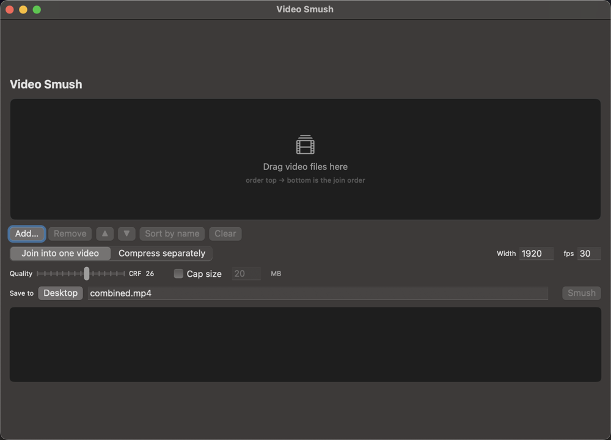

# Video Smush

A tiny macOS app that compresses a pile of videos and joins them into one file.

Built for screen recordings: tools like CleanShot capture at 120 fps and full Retina
resolution, producing 250 MB files for ten minutes of mostly-static UI. Video Smush
turns those into ~15 MB without the text going soft.



## What it does

- **Drag in any number of videos** — they're compressed and concatenated into one file.
- **Order is the join order**, top to bottom. Drag to reorder, or sort by name
  (which puts timestamped screen recordings in chronological order).
- **Lossless join.** Every clip is re-encoded to one common canvas first, so the final
  concatenation is a stream copy — no clip pays for a second compression generation.
- **Size cap.** Ask for "under 20 MB" and it switches to two-pass VBR and hits it.
- **Compress-separately mode** when you don't want them joined.
- **Parallel encoding**, 1–6 clips at a time.

Typical result on a 120 fps Retina screen recording: **250 MB → 15 MB**, around 94% smaller,
with UI text still crisp. Most of the saving comes from the frame rate — screen content
gains nothing from 120 fps.

## Requirements

- macOS 13+
- [ffmpeg](https://ffmpeg.org) on `PATH` (`brew install ffmpeg`)

## Build

```sh
./build.sh
cp -R "build/Video Smush.app" /Applications/
```

The app is ad-hoc signed, so the first launch needs **right-click → Open** to get past
Gatekeeper. After that it opens normally.

## Settings

| Setting | Default | Notes |
|---|---|---|
| Width | 1920 | Height is derived from the first clip's aspect ratio |
| fps | 30 | Screen recordings gain nothing above this |
| Quality (CRF) | 26 | Lower = better; 18–32 range. Ignored when a size cap is set |
| Cap size | off | Switches to two-pass VBR to land under the given MB |
| Parallel | 2 | Clips encoded simultaneously |

## CLI

The same binary runs headless:

```sh
"/Applications/Video Smush.app/Contents/MacOS/VideoSmush" --cli \
  --out combined.mp4 --max-mb 20 --jobs 2 clip1.mp4 clip2.mp4
```

| Flag | Meaning |
|---|---|
| `--out NAME` | Output filename (join mode) |
| `--dir PATH` | Output directory (default: Desktop) |
| `--width N` / `--fps N` | Output geometry |
| `--crf N` | Quality, 18–32 |
| `--max-mb N` | Size ceiling; enables two-pass |
| `--jobs N` | Clips encoded in parallel |
| `--separate` | Compress each clip, don't join |

Exits non-zero on failure.

## How the join stays lossless

Concatenating H.264 by stream copy requires every segment to share resolution, frame rate
and pixel format. Source clips rarely match — a window captured at 3024×1964 and another at
3018×1964 scale to 1246 and 1250 lines respectively, which is enough to break the copy.

Video Smush picks one canvas from the first clip and forces every clip onto it
(`scale=W:H,setsar=1,fps=N`). Aspect differences of a fraction of a percent are absorbed
rather than letterboxed. The concat demuxer then runs with `-c copy`.

## Performance notes

Parallelism helps less than you'd expect, because x264 is already multithreaded and
saturates available cores on its own. Measured on a 12-core M-series machine:

| Workload | `--jobs 1` | `--jobs 2` | `--jobs 4` |
|---|---|---|---|
| 2 long clips (16 min total) | 106 s | 96 s | — |
| 5 short clips (3.5 min total) | 22 s | 24 s | 35 s |

Output is byte-for-byte identical regardless of `--jobs`. The win shows up on a few long
clips, where one encode's single-threaded phases overlap another's parallel ones. For many
short clips the lanes just contend — set **Parallel to 1** there.

## License

MIT
